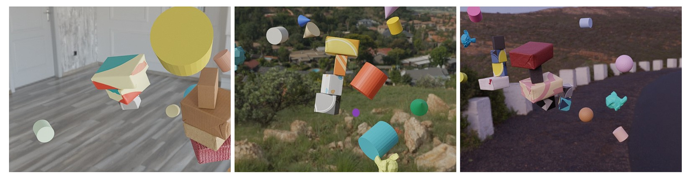
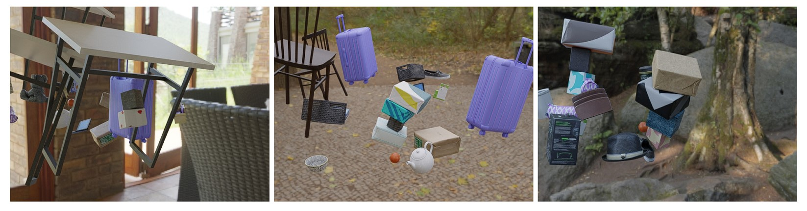
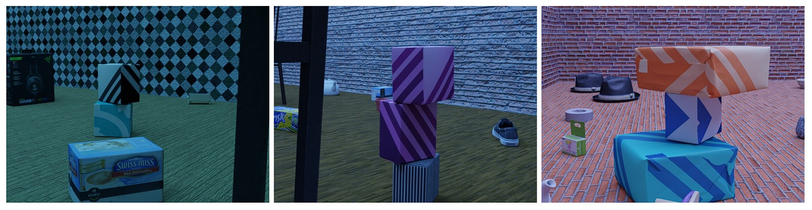
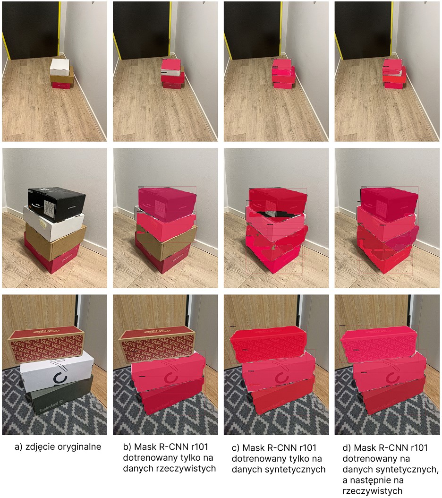

# Enhancing Deep Learning with Synthetic Data

## Overview

Deep neural networks achieve remarkable results in tasks related to environmental perception. However, training these models requires an enormous amount of data. One potential solution to this problem is **synthetic data generation**.

This project explores methods for generating synthetic data and techniques to improve model predictions trained with them. Experiments were conducted to evaluate synthetic datasets for **object detection** and **instance segmentation**. The results demonstrate the **positive impact** of synthetic data on deep neural network training.

## Features

- **Synthetic Data Generation** – Create realistic datasets for training deep learning models.
- **Performance Evaluation** – Assess the impact of synthetic data on model accuracy.
- **Object Detection & Instance Segmentation** – Test synthetic datasets on computer vision tasks.

## Synthetic Data Samples

### Below are examples of **generated synthetic images** used for training:

### Examples derived from a collection based on randomisation of the domain using objects with random shapes as noise

### Examples derived from a collection based on domain randomisation using 3D models of household objects as noise

### Examples from the realism-based collection

## Results

### The table below presents the results of experiments comparing models trained with real vs. synthetic data.

| **Dataset**                                                        | **Model**       | **mAP** |
| ------------------------------------------------------------------ | --------------- | ------- |
| Domain randomization using objects with random shapes as noise     | Mask R-CNN r50  | 0.791   |
|                                                                    | Mask R-CNN r101 | 0.811   |
| Domain randomization using 3D models of household objects as noise | Mask R-CNN r50  | 0.803   |
|                                                                    | Mask R-CNN r101 | 0.855   |
| Realistic                                                          | Mask R-CNN r50  | 0.597   |
|                                                                    | Mask R-CNN r101 | 0.631   |
| Domain randomization + realistic                                   | Mask R-CNN r50  | 0.734   |
|                                                                    | Mask R-CNN r101 | 0.789   |
| Real                                                               | Mask R-CNN r50  | 0.877   |
|                                                                    | Mask R-CNN r101 | 0.901   |
| Domain randomization + real                                        | Mask R-CNN r50  | 0.939   |
|                                                                    | Mask R-CNN r101 | 0.959   |

### Example instance segmentation test

